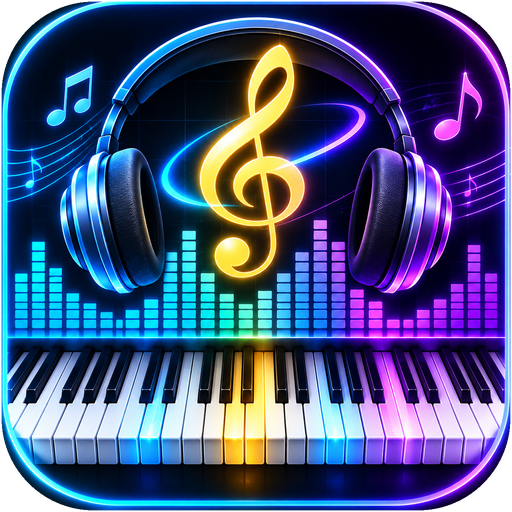
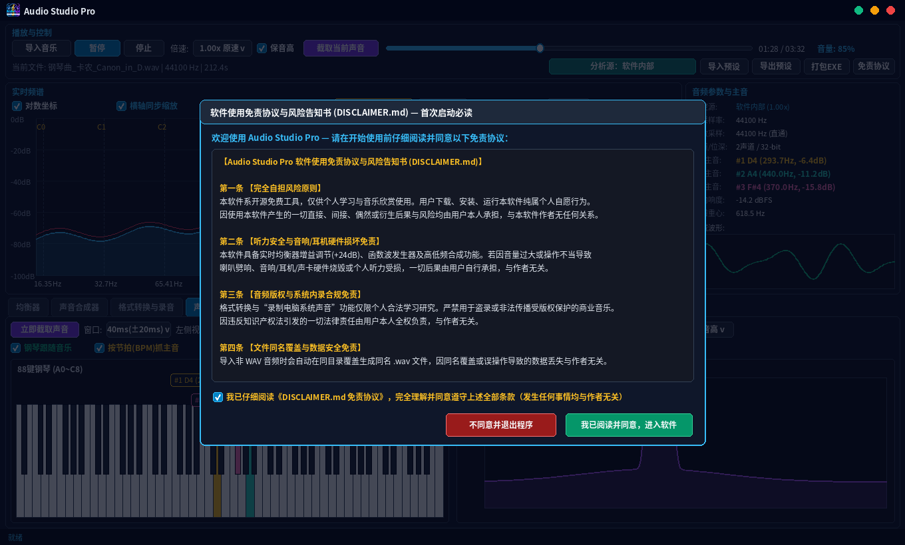
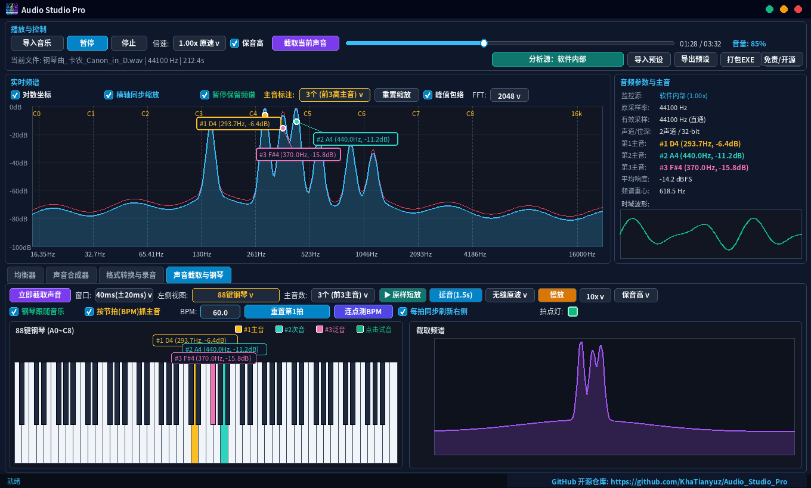
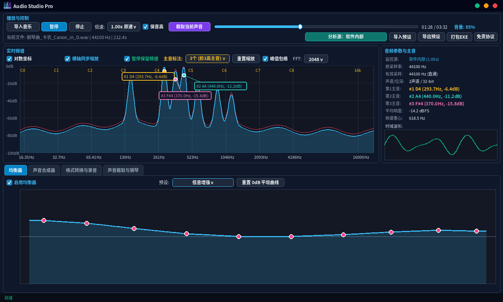
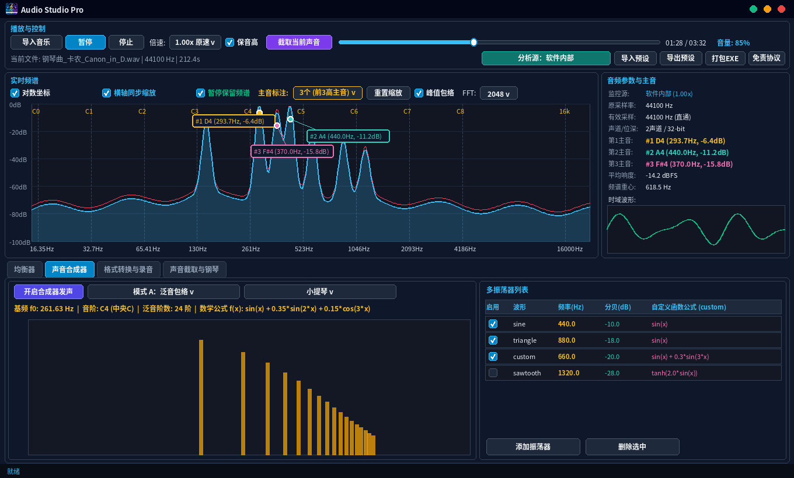

  

# 🎵 Audio Studio Pro：音乐看音、88键钢琴跟谱与调音工具（Python & C++ 双版本开源）

> **这是一个免费的桌面小工具，让你用眼睛看懂音乐，用钢琴跟着歌曲找音，把一闪而过的声音放慢听清楚，还能自由调音和录电脑声音。**
> 哪怕你完全不懂乐理，也从来没写过一行代码，打开就能直接用！

---

## ⚠️ 使用前必读：安全提示与免责声明摘要

第一次打开本软件时，屏幕上会弹出 **《软件使用免责协议与风险告知书 (DISCLAIMER.md)》** 窗口，您需要阅读并勾选 **“我已阅读 DISCLAIMER.md 并遵守以下协议”** 后才能进入软件。

- **完全自担风险（与作者无关）**：本软件为个人免费开源分享工具。**任何人使用本软件发生的任何事情（包括但不限于耳机/音响喇叭损坏、听力不适、音乐文件同名覆盖、电脑卡顿闪退、音频版权纠纷等）均由使用者本人自行承担全部责任，与软件作者无任何关系。**
- **保护耳朵和喇叭**：在尝试“拉高低音”或“开启合成器发声”前，请先把电脑音量调小（建议 20% 以下），确认声音温和不刺耳后再慢慢调大。
- 完整 10 条免责条款请见本文末尾或仓库根目录下的 [`DISCLAIMER.md`](DISCLAIMER.md)。

---

## 🖼️ 软件长什么样？（运行画面一览）

### 主界面：一边听歌，一边看当前唱的是哪个音 + 88 键钢琴自动跟着亮灯

### 拖动圆点就能调音质：低音再猛也不会破音的均衡器

### 模拟小提琴/长笛音色，自己创造声音，边听边转换格式与电脑内录

---

## 🤔 这个软件里有两个版本（Python 版 和 C++ 版），我该用哪个？

本项目同时开源了 **Python 版本（在 `python_version` 文件夹）** 和 **C++ 版本（在 `cpp_version` 文件夹）**。
**两个版本在功能和操作方法上一模一样，界面布局与按钮位置也相同！** 你可以按下面的大白话直接二选一。

| 对比项目 | 📁 **C++ 版本 (`cpp_version`)** | 📁 **Python 版本 (`python_version`)** |
| :--- | :--- | :--- |
| **适合谁用** | 追求**打开速度快、占内存极小**，希望**画面最丝滑**的普通用户 | 电脑上装过 Python，或者想双击脚本自动装好环境直接跑的用户 |
| **运行速度与体积** | 极快（点开秒进，就一个几兆大小的 `.exe` 小文件） | 功能完全相同，打包后的文件夹体积稍大一些（包含完整音频库） |
| **功能有没有差别** | **完全一样**（从看主音、88键钢琴跟拍，到倍速保音高、慢放、调音和内录全都有） | **完全一样**（两个版本操作体验一致，预设文件 `.json` 也互相通用） |

---

## 🚀 零基础怎么打开使用？（完全不需要懂编程）

### 方法一：直接用打包好的免安装版（最省心，推荐！）
1. 如果你拿到的是已经打包好的文件夹（或从 GitHub Releases 下载的压缩包），**先把压缩包完整解压出来**。
2. 找到里面的 **`AudioStudioPro.exe`**，直接用鼠标**双击打开**即可！
3. 第一次打开会弹出免责协议窗口，打勾 **“我已阅读 DISCLAIMER.md 并遵守以下协议”**，点击绿色按钮 **“我已阅读并同意，进入软件”** 就能开始用了。

### 方法二：如果你下载的是本开源代码包，想自己生成 `.exe` 程序
- **想打包 Python 版**：
  1. 电脑上如果还没装 Python，去 Python 官网装一个（安装时记得勾选底部的 `Add Python to PATH`）。
  2. 打开 `python_version` 文件夹，直接用鼠标双击 **`build_exe.bat`**。
  3. 它会自动帮你下载好所有需要的零件，并在 `dist\AudioStudioPro` 文件夹里生成免安装的 **`AudioStudioPro.exe`**，生成完还会自动帮你弹出文件夹！以后你把这个文件夹发给任何朋友，对方电脑不用装任何东西就能直接双击用。
- **想编译 C++ 版**：
  1. 如果你电脑上装有 Visual Studio（勾选了 C++ 桌面开发）和 CMake，打开 `cpp_version` 文件夹，直接双击 **`build_cpp.cmd`**（或用 Visual Studio 直接打开 `cpp_version` 文件夹）。
  2. 它会自动拉取所需界面组件并生成单文件版 **`build\Release\AudioStudioPro.exe`**。

---

## 📖 超详细大白话功能与按钮说明书（一看就会）

下面按软件从上到下的顺序，逐个说明每个按钮的用法。

### 最上面一排：放歌、调倍速与听电脑里的声音

1. **怎么把歌放进去听？（【导入音乐】按钮 或 直接鼠标拖入）**
   - 你可以点击左上角的 **【导入音乐】** 按钮选歌，或者**直接用鼠标把电脑里的音乐文件（不管是 `.mp3`、`.flac`，还是 `.wav`、`.ogg`、`.m4a`）拖进软件窗口里松手**！
   - **贴心小功能**：如果拖进去的不是 `.wav` 格式（比如你拖了 `卡农.mp3`），软件会自动在同一个文件夹下帮你转换成一份标准无损的 **`卡农.wav`** 并马上开始播放，再也不会遇到“格式不支持”的报错。
2. **怎么把歌放慢或加快听，但歌手声音不变怪？（【倍速】+【保音高】）**
   - 在 **【倍速】** 下拉框里，你可以选 `0.25x 极慢`、`0.50x 慢速`、`0.75x 稍慢` 到 `2.00x 倍速`。
   - 旁边有一个 **【☑ 保音高】** 小勾选项（默认已打勾）。
     - **打勾时（推荐）**：歌曲速度变慢或变快，但**原有的音调高低完全不变**，而且经过专门防爆音处理，喇叭绝对不会有“哒哒”劈响，非常适合放慢速度扒谱、学唱歌或听清快速的乐器演奏。
     - **取消打勾时**：就像老式磁带机一样，放慢时声音会变得低沉粗犷，加快时变成“花栗鼠音”。
3. **怎么让软件分析网易云、QQ音乐、网页视频里的声音？（【分析源】切换按钮）**
   - 默认按钮显示 **【分析源：软件内部】**，意思是只看你拖进本软件里的音乐。
   - 你点击一下这个绿色按钮，它会变成橙色的 **【分析源：系统声音】**！这时候你不需要导入任何文件，直接打开电脑上的音乐播放器、B站视频或游戏，只要电脑有声音响，软件就能实时把它的音高、频谱和钢琴琴键画出来！

---

### 上半部分：实时看歌里正在响的是哪几个音

1. **看波峰上的小卡片，直接认识当前的主音**
   - 音乐响起时，上半部分的蓝色山峰图（频谱图）会跟着声音高低起伏。山峰最高的地方，就是当前声音里最响的音（主音）。
   - 软件会自动在最高峰顶上挂出彩色小卡片，比如 **`#1 D4 (293.7Hz, -6.4dB)`**。
     - **`#1`（金色）**：当前最响的第 1 主音（通常是主旋律或重低音）。
     - **`#2`（青绿色）**：第二响的音（通常是和弦伴奏音或二声部）。
     - **`#3`（粉紫色）**：第三响的音（通常是陪衬音或高音泛音）。
   - 画面上还有竖着的虚线，标着 **`C0`、`C1` ... `C4（中央C）` ... `C8`**，对应钢琴从最左到最右的每个八度位置。
2. **觉得标 3 个音眼花？随时切换标几个！（【主音标注】下拉框）**
   - 点击 **【主音标注】** 下拉框可以自由切换显示个数。
     - **`0个 (不标注)`**：只看纯粹的蓝色频谱起伏，不显示任何文字卡片。
     - **`1个 (仅第1主音)`**：只标最响的那 1 个音，画面最清爽（默认推荐）。
     - **`2个 (前2高主音)`** 或 **`3个 (前3高主音)`**：同时看主音和伴奏和弦音。
3. **想暂停下来慢慢看清刚才那个音？（【☑ 暂停保留频谱】）**
   - 勾选 **【☑ 暂停保留频谱】** 后，你听到某个想研究的音，只要点一下左上角的 **【暂停】**，画面上的蓝色山峰和音名卡片就会**立刻定格锁住在屏幕上**，不会因为声音停了就消失归零，方便你慢慢看。

---

### 下半部分第 4 页：88 键钢琴键盘、按节拍抓主音与截取瞬间声音慢放

这是学琴、扒谱和找调常用的核心页面（点击下方第 4 个标签页 **【声音截取与钢琴】**）。

1. **88 键标准钢琴键盘（会发光，还能拿鼠标弹！）**
   - 在 **【左侧视图】** 下拉框里选择 **【88键钢琴】**，左边就会展现出一架完整的 88 键钢琴（52 个白键 + 36 个黑键，从最左边的 `A0` 到最右边的 `C8`）。
   - 歌曲播放时，当前唱到的主音会在对应的**钢琴琴键上直接填色点亮**（金色是第 1 主音，青绿色是第 2 主音，粉紫色是第 3 主音），琴键正上方还会用虚线连着气泡卡片告诉你这是什么音！
   - **鼠标点琴键直接试音**：你觉得歌里某个音听不准？直接用鼠标左键**点一下画面上的任意白键或黑键**，软件就会立刻弹响那个琴键的标准钢琴音，让你亲耳比对准不准！
2. **嫌钢琴灯闪得太快看不清？打开【☑ 按节拍(BPM)抓主音】！**
   - 如果钢琴灯实时跳动太快，勾选第 2 行的 **【☑ 按节拍(BPM)抓主音】**。
   - **设置 BPM（每分钟拍数）**：比如你把 **【BPM】** 设为 **`60.0`**（一分钟 60 拍，也就是 **1 秒钟 1 拍**），那么钢琴键盘就**每隔整整 1 秒钟才抓取一次当前的主音**，并且在这一秒内稳稳地停在钢琴上完全不变，直到下一秒到来才换下一次！每次抓拍的瞬间，右边的绿色 **【拍点灯】** 小方块会闪一下。
   - **节拍跟歌没对上怎么办？点一下【重置第1拍】！**
     - 你听着歌里的鼓点或重音落下，顺手点一下 **【重置第1拍】** 按钮，软件就会**从你按下的这一瞬间立刻记作第 1 拍**抓取主音，后面就严丝合缝地跟着你的节拍走了！
   - **不知道这首歌是多少拍（BPM）？点几下【连点测BPM】！**
     - 跟着音乐的拍子，用鼠标连续点 3~5 下 **【连点测BPM】** 按钮，软件就会自动算出你点按的节奏是多少 BPM，自动填进框里并帮你对齐第一拍！
   - **【☑ 每拍同步刷新右侧】**：勾选后，每一拍不仅更新左边的钢琴，还会自动把右边定格的紫色频谱图也跟着每一拍刷新一次。
3. **把一闪而过的 0.04 秒声音“抓下来”拉长听、慢放听！**
   - 歌里有个转音或和弦太快，一眨眼就过去了？随时点击紫色的 **【立即截取声音】** 按钮！
   - 软件会把你按下瞬间前后几十毫秒（比如 `40ms`）的声音抓下来，提供 **3 种神奇的回放方式**。
     - **【▶ 原样短放】**：听一下刚刚抓下来的那原汁原味的一小声。
     - **【延音(1.5s)】**：把原本只有一眨眼（0.04 秒）的声音，**平滑拉长成 1.5 秒的长音**播放出来（可选“无缝原波”或只听最干净的“纯谐波延音”），让你一下子听清里面的音高！
     - **【慢放】（2x ~ 20x）**：把这一瞬间慢放 2 倍、5 倍，甚至 10 倍、20 倍（可选“保音高”慢放或“物理降频”慢放），把声音振动的每一个细节听得清清楚楚。
   - 如果把 **【左侧视图】** 切换回 **【时域波形】**，你还能看到绿色的真实声音振动波，以及拆解出来的金色、青色和粉色三条正弦波虚线！

---

### 下半部分第 1 ~ 3 页：调均衡器、模拟乐器发声，以及转换格式与录电脑声音

1. **第 1 页：【均衡器】，随便拉重低音也不会劈响**
   - 图上有一条蓝色平滑曲线和一排粉红色圆点（左边是低音，中间是人声中音，右边是高音）。
   - **怎么调**：直接用**鼠标左键按住粉红圆点往上拉**就是增强这个频段，往下拉就是减弱；**双击空白处**可以增加新圆点精细调节；**右键点击圆点**可以删掉它；也可以直接在 **【预设】** 里选 `低音增强`、`人声清晰`、`摇滚现场`。
   - **为什么不会破音**：普通软件把低音拉高后喇叭容易“劈啪”爆音，本软件内置了自动余量保护和防爆音限幅，怎么拉都顺滑耐听。
2. **第 2 页：【声音合成器】，模拟乐器音色或自己造声音**
   - 点击 **【开启合成器发声】**，软件就会按你选的音高（比如中央 C `C4 = 261.63 Hz`，或直接点下面的 `C0 ~ C8` 快捷按钮）发出声音。
   - 这里支持 **3 种发声模式**。
     - **模式 A（泛音包络）**：在右侧音色预设里选 `小提琴`、`单簧管`，或者选 `长笛`、`铜管小号`、`管风琴`，也可以自己拖动紫色的泛音包络线，听听不同乐器为什么音色不同！
     - **模式 B（多波混音）**：在右边的表格里自己添加好几个不同频率、不同分贝的波叠加在一起听和弦。
     - **模式 C（数学公式）**：在公式框里输入像 `sin(x) + 0.35*sin(2*x)` 这样的公式，点 **【用公式发声(模式C)】**，就能直接听见数学公式变成的声音！
3. **第 3 页：【格式转换与录音】，听复古音质、转格式与录电脑声音**
   - **左边（重采样与格式转换）**：
     - 勾选 **【☑ 开启实时重采样】**，你可以在听歌的同时把采样率调低（比如 `8000 Hz` 电话音质）或把位深调成 `8-bit`（复古红白机游戏音质），实时听变化、看频谱被削掉高频的样子！
     - 点击蓝色的 **【导出音频文件】**，可以把当前音乐转换成 `wav`、`mp3`、`flac`、`ogg`、`m4a`、`aac` 等任意格式保存下来。
   - **右边（声音录制）**：
     - 在 **【选择录制源】** 里，你可以选择 **“软件内部声音”**（比如把你调好均衡器或弹奏合成器的声音录下来），或者选择 **“电脑系统声音”**。
     - 点击红色的 **【开始录制声音】**，录完后点绿色的 **【导出保存录音文件】**，就能存成 `.wav` 或 `.mp3` 等文件！

---

## ❓ 常见问题解答（外行用户必看 FAQ）

1. **问：我把 `.mp3` 拖进软件后，文件夹里多了一个同名的 `.wav` 文件，这是正常的吗？**
   - **答**：完全正常！为了保证任何格式的音乐都能流畅倍速、截取和慢放，软件在导入非 `.wav` 音乐时，会自动在同文件夹下转出一份标准 `.wav` 文件。如果原文件夹里已经有同名 `.wav`，会被自动覆盖，所以平时不要把重要的原版 `.wav` 和同名的 `.mp3` 混放在一起即可。
2. **问：软件窗口在我的笔记本电脑或老显示器上会不会太大、右边超出屏幕？**
   - **答**：不会！无论你的屏幕是宽屏（16:9，比如 1920×1080、1366×768）还是方屏（4:3，比如 1024×768、1280×960），甚至开了 125% / 150% 字体放大，软件启动时都会自动测量你的屏幕大小并缩放至合适尺寸，所有按钮也都分成了上下两行紧凑排布。
3. **问：双击 `build_exe.bat` 打包后生成的 `build` 文件夹和 `AudioStudioPro.spec` 文件能删吗？**
   - **答**：随时可以删！打包完成后，你真正要用的只有 **`dist\AudioStudioPro`** 文件夹（里面有 `AudioStudioPro.exe`），其余的 `build` 文件夹和 `.spec` 文件都是打包过程的临时草稿，删掉完全不影响使用。
4. **问：以后我想再次查看免责协议怎么办？**
   - **答**：随时点击软件最上方工具栏第 2 行最右侧的 **【免责协议】** 按钮，或者直接打开软件目录下的 `DISCLAIMER.md` 文件即可查看。

---

## 📜 软件使用免责协议（完整版条款）

> **再次郑重声明：使用本软件发生的任何事情均与本软件作者无关。以下为完整免责协议条款（与软件内置弹窗及根目录 `DISCLAIMER.md` 完全一致）。**

1. **【第一条：完全自担风险与作者免责总则】**
   本软件系个人开发的免费开源工具（基于 GNU AGPL v3.0 协议发布），仅供个人日常音乐欣赏、乐理学习与声学兴趣体验使用。用户下载、安装、运行、操作或修改本软件纯属个人自愿行为。**无论是谁在何种场景下使用本软件，因使用或无法使用本软件所引发的一切直接、间接、偶然、特殊、附带或衍生后果、事故、纠纷、损失与风险，均由使用者本人 100% 独立承担，与本软件作者无任何关系，作者在任何情况下均不承担任何民事、行政或刑事责任，亦不承担任何经济赔偿义务。**
2. **【第二条：听力健康安全与音响/耳机/电脑硬件免责】**
   本软件包含均衡器音量增益调节（最高 +24dB）、自定义声音发生器、多声音叠加合成及高低频声波发生功能。若因用户将音量调得过大、大幅拉高增益、输入剧烈振荡公式，或在佩戴耳机、连接外置音箱/功放/声卡时操作不当，导致**个人或他人耳鸣、听力下降、永久性听力损伤等健康损害，或导致耳机破损、音响喇叭劈响烧毁、功放或声卡硬件故障，一切后果与费用均由用户自行承担，与本软件作者无关。**
3. **【第三条：音乐版权合规与“录制电脑声音”法律责任免责】**
   本软件内置的“音频格式转换”、“重采样导出”及“录制电脑系统声音”功能，仅限用于用户拥有合法权利的音频素材或个人非商业学习研究。严禁利用本软件盗录、破解、非法转换或传播受著作权法保护的商业音乐、流媒体音视频或他人隐私语音。**因用户违反知识产权法律法规或侵犯第三方合法权益所引发的一切法律纠纷、赔偿或处罚，均由用户本人全权负责，与本软件作者无任何关联。**
4. **【第四条：同名文件自动覆盖与个人数据安全免责】**
   您向本软件导入非 `.wav` 格式的音乐文件，软件会自动在原文件同一文件夹下覆盖生成同名的 `.wav` 文件。**因同名文件自动覆盖、用户误操作、路径选择不当或程序中断导致的任何文件丢失、原始音频被覆盖或数据损坏，责任完全由用户自行承担，作者概不负责。**
5. **【第五条：系统兼容性、杀毒软件误报与运行故障免责】**
   作者不保证本软件在所有 Windows 系统版本、声卡驱动或硬件环境下均能正常无误运行。**若因运行本软件引发音频爆音、程序闪退、驱动冲突、系统死机蓝屏或未保存的数据丢失，均与本软件作者无关。**
6. **【第六条：音名识别准确性与“按原样 (AS-IS)”无担保条款】**
   本软件按“原样 (AS-IS)”提供，不附带任何明示或暗示的担保。软件显示的频谱、第一/第二/第三主音音名、88 键钢琴高亮及 BPM 数值仅供参考，不保证 100% 准确。**因依赖软件显示结果而导致的任何考试失利、演出失误或商业损失，与作者无关。**
7. **【第七条：无强制维护与技术支持义务条款】**
   作者未向用户收取任何费用，**不负有任何提供技术支持、解答疑问、修复缺陷或后续升级更新的强制义务。**
8. **【第八条：第三方修改版与二次分发免责】**
   任何第三方对本软件进行修改、重新打包或分发时，其行为仅代表该第三方自身。**因下载使用第三方篡改版、捆绑版引起的病毒木马、隐私泄露或财产损失，与原作者无任何关系。**
9. **【第九条：未成年人使用特别提示】**
   未成年人必须在父母或法定监护人的全程指导与监督下阅读本协议并使用本软件，监护人应承担全部安全监护责任。
10. **【第十条：放弃追索权与协议生效】**
    **一旦您勾选同意本协议或开始使用本软件，即表示您永久且不可撤销地放弃因使用本软件而向软件作者提起任何索赔、投诉、仲裁或诉讼的权利。**

---

## 📄 开源协议 (License)

本项目（含 `python_version` 与 `cpp_version` 全部源代码与文档）采用 **[GNU Affero General Public License v3.0 (AGPL-3.0)](LICENSE)** 协议开源。
任何基于本项目的修改、衍生作品或网络服务分发，均须保持相同的 AGPL-3.0 开源协议，并完整保留原作者版权声明及 [`DISCLAIMER.md`](DISCLAIMER.md) 免责协议。
